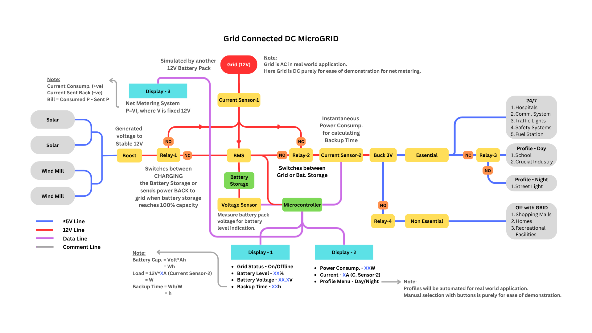

# Grid-Connected DC Microgrid with Net Metering

**Team SYNDICATE-32** · Arduino-based educational prototype

A compact DC microgrid that combines solar and wind inputs, a 3S battery pack and a (simulated) grid.
It switches automatically to battery backup when the grid fails, sheds non-essential loads, and feeds
excess renewable energy back to the grid once the battery is full (net metering).



> In the real world the grid is AC. Here it is a second 12 V battery pack, purely to make net metering
> easy to demonstrate.

## Features

- **Automatic grid ↔ battery switching** (Relay-2) driven by a 5 V grid-sense signal
- **Net metering**: renewables charge the battery; above 95 % the surplus is routed to the grid (Relay-1)
- **Load prioritisation**: essential loads stay on during an outage, non-essential loads are cut (Relay-4)
- **Day / night load profiles** selected from an LDR (Relay-3)
- **Three 16×2 I²C LCDs**: grid and battery status, load power, net-metering power
- **Audible grid alerts**: one beep when the grid comes back, two when it drops
- **Serial JSON telemetry** (115200 baud) for the NodeMCU ESP8266 IoT dashboard
- **Town-map demo**: 4-way traffic light controller as a 24/7 essential load

## Repository layout

```
dc-microgrid/
├── firmware/
│   ├── microgrid_controller/microgrid_controller.ino   # main controller (Arduino Uno)
│   └── traffic_light/traffic_light.ino                 # traffic-light load demo
├── docs/
│   ├── Report.pdf              # project report
│   ├── architecture.md         # control logic and signal flow
│   ├── pin-map.md              # pins, relays, I2C addresses
│   └── images/                 # workflow diagram and town maps
├── hardware/
│   └── bom.md                  # components and cost
├── LICENSE
└── README.md
```

## Quick start

1. Install the Arduino IDE and the **LiquidCrystal_I2C** library (Library Manager).
2. Wire the hardware following [`docs/pin-map.md`](docs/pin-map.md).
3. Make sure **no load current is flowing** at power-up (see *Calibration*).
4. Open `firmware/microgrid_controller/microgrid_controller.ino`, select the board and upload.
5. Open the Serial Monitor at **115200 baud** to see the JSON stream.

The traffic-light sketch (`firmware/traffic_light/`) is uploaded to a separate board.

## Calibration

Constants at the top of `microgrid_controller.ino`:

| Constant | Value | Meaning |
|---|---|---|
| `VREF` | 5.00 | ADC reference voltage |
| `SENSITIVITY_V_PER_A` | 0.066 | ACS712 sensitivity (matches the 30 A variant) |
| `VOLTAGE_SCALE` | 3.65 | Voltage-sensor scale factor; tune against a multimeter |
| `BATTERY_V_MIN` / `BATTERY_V_MAX` | 9.6 V / 12.0 V | 0 % and 100 % battery voltage |
| `NOMINAL_V` | 12.0 | Fixed bus voltage used for P = V·I |
| `LDR_THRESHOLD` | 500 | ADC value above which it counts as day |

At start-up the sketch averages 1000 samples on both ACS712 sensors to find their zero-current offset,
so **both sensors must see zero current during boot**.

## Control logic (summary)

| Relay | Pin | Behaviour |
|---|---|---|
| Relay-1 | D2 | Battery > 95 % → export to grid; < 90 % → charge (hysteresis) |
| Relay-2 | D3 | Grid online → grid (NC); grid offline → battery (NO) |
| Relay-3 | D4 | Day → NC profile; night → NO profile |
| Relay-4 | D5 | Non-essential loads enabled only while the grid is online |

All relays are active LOW. Details in [`docs/architecture.md`](docs/architecture.md).

## Serial telemetry format

One JSON line per loop for the ESP8266:

```json
{"grid":1,"battPct":87.5,"battV":11.62,"Pload":6.2,"Iload":0.52,"isDay":1,"Pnet":-1.4,"Inet":-0.12}
```

| Field | Meaning |
|---|---|
| `grid` | 1 = grid online, 0 = offline |
| `battPct`, `battV` | Battery level (%) and voltage (V) |
| `Pload`, `Iload` | Load power (W) and current (A) from ACS-2 |
| `isDay` | 1 = day, 0 = night (LDR) |
| `Pnet`, `Inet` | Net-metering power (W) and current (A) from ACS-1; positive = consumed, negative = sent back |

## Cost

Estimated prototype cost: **BDT 5,285**. Breakdown in [`hardware/bom.md`](hardware/bom.md).

## Known gaps

These are differences between the supplied files, left as-is rather than guessed at:

- **No ESP8266 firmware** was provided. The report describes a NodeMCU web server, and the controller
  already emits JSON for it.
- **Backup-time estimate** (shown on Display-1 in the workflow diagram) is not implemented in the
  controller firmware.
- **Pin notes vs code**: the original pin notes list Relay-4 as "Night"; the firmware uses Relay-4 for
  non-essential loads and Relay-3 for day/night, matching the workflow diagram. The firmware also
  adds the grid-sense input (D6) and buzzer (D7).
- **Battery range**: the original notes use 9.5 V–12.6 V for 0–100 %; the firmware uses 9.6 V–12.0 V.
- The traffic-light sketch uses pins 2–13, which overlap the controller's relay pins, so it needs its
  own board.

## Documents

- [Project report](docs/Report.pdf)
- [Town map 1](docs/images/town-map-1.png) · [Town map 2 (parking layout)](docs/images/town-map-2.png)

## License

MIT. Change it if your course or team requires otherwise.
