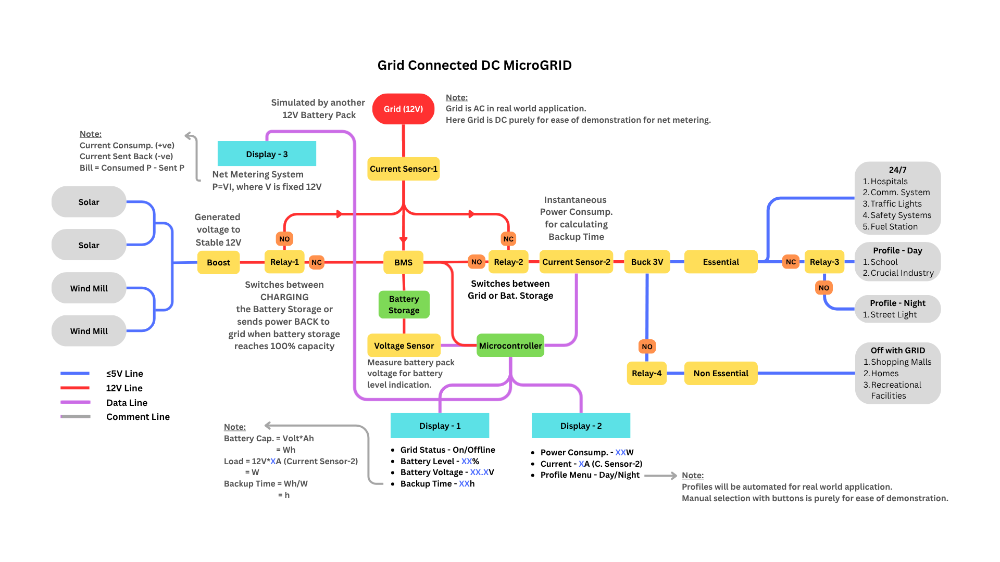
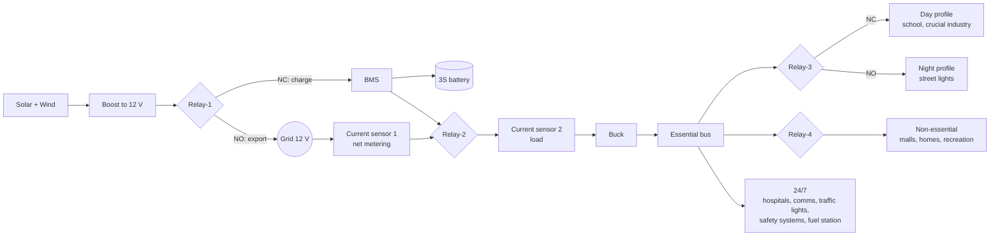

# Architecture and Control Logic

## Power flow

## Control rules

Run once per loop (about every 250 ms):

1. **Grid sense (D6)** – HIGH means online. On a change the buzzer beeps once (online) or twice (offline).
2. **Measure** – ACS-1, ACS-2 and the battery voltage are each averaged over 100 samples, then low-pass
   filtered (α = 0.30).
3. **Power** – `P_load = I_load × 12 V`, `P_net = I_net × 12 V`.
4. **Battery %** – linear between 9.6 V (0 %) and 12.0 V (100 %), clamped to 0–100.
5. **Relays**

| Relay | Condition | Coil | Result |
|---|---|---|---|
| 1 | battery > 95 % | LOW | Export surplus to grid |
| 1 | battery < 90 % | HIGH | Charge battery |
| 2 | grid online | HIGH | NC, load on grid |
| 2 | grid offline | LOW | NO, load on battery |
| 3 | day (LDR > 500) | HIGH | NC, day profile |
| 3 | night | LOW | NO, night profile |
| 4 | grid online | LOW | Non-essential loads on |
| 4 | grid offline | HIGH | Non-essential loads shed |

Between 90 % and 95 % Relay-1 holds its previous state (hysteresis).

## Net metering convention

- Current consumed from the grid is positive; current sent back is negative.
- Bill = consumed energy − energy sent back, with P = V·I and V fixed at 12 V.

## Planned in the design but not in the firmware here

- Backup time = battery energy (V × Ah, in Wh) ÷ load power (W), shown on Display-1.
- IoT dashboard on the NodeMCU ESP8266 showing battery status, mode and backup estimate.
- Automatic day/night profiles are done with the LDR; the diagram also mentions manual button selection for demos.
